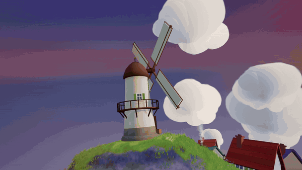
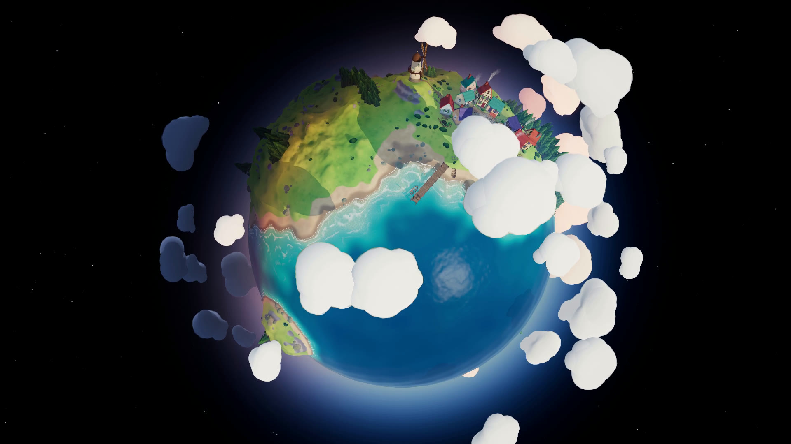
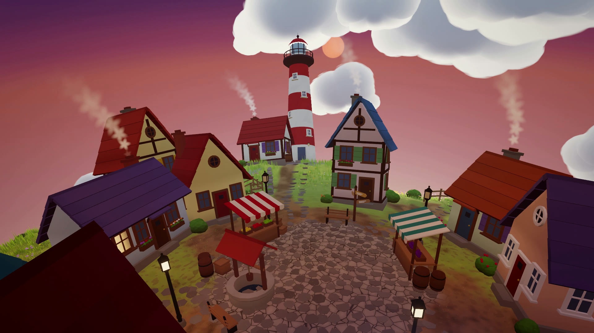

# Tiny Planet

A small round world you can walk and fly around in the browser, built in Three.js. It has a turquoise
sea and pale beaches, rolling grass hills that sway in the wind, a pine forest, a village of eleven
cottages around a cobbled square, a lighthouse on a rocky cape and a windmill that turns on its hill.
Clouds orbit overhead and cast shadows. Gravity pulls toward the centre, so you can walk all the way
round, over the poles and back to where you started.

The sun stays put while the planet turns under it, so one side is always at sunset. Walk toward the
terminator and the light warms to orange, the sky turns pink, and the cottage windows and street
lamps come on one by one. On the night side the lighthouse beam sweeps the sea.

Everything is made in code: the terrain, water, grass, trees, buildings, clouds, sky and sound. No
models, textures, fonts or audio were downloaded.



**Play it here: https://starknightt.github.io/tiny-planet/**

You need a keyboard and a mouse. It was built and measured in Chrome on Windows with an RTX 4060.

## Controls

Click the title screen to start. The mouse is captured until you press Esc.

| Key | Action |
| --- | --- |
| W A S D / arrow keys | Walk |
| Mouse | Look |
| Shift | Run |
| Space | Jump (climb while flying) |
| C / Ctrl | Descend while flying |
| F | Toggle flying: rise above the clouds and look at the whole planet |
| M | Mute the ambient sound |
| Esc | Pause |



## Tech stack

- **Three.js 0.187** (WebGL2) with a hand-written post pass: HDR, MSAA, bloom, ACES tone mapping,
  colour grade, vignette and dither.
- **TypeScript** (strict) and **Vite**, with **pnpm**. `three` is the only runtime dependency.
- **One shadow-casting sun.** Its colour is worked out per pixel from the local sun height, so noon,
  sunset and night all exist on the planet at once.
- **Web Audio** for the ambient sound: wind, waves and birds synthesised in the browser.
- **Playwright and ffmpeg (NVENC)** for the tooling only: GPU screenshots and an offline, frame-by-frame
  1080p60 recording of the cinematic fly-in.

## Running it locally

```
git clone https://github.com/StarKnightt/tiny-planet.git
cd tiny-planet
pnpm install
pnpm dev          # http://127.0.0.1:5173/
pnpm build        # type-check, then a production build into dist/
pnpm preview      # serve dist/
```

The build uses a relative base, so `dist/` works from any sub-path, including `/tiny-planet/` on
GitHub Pages. Pages is deployed by `.github/workflows/deploy.yml` on every push to `main`.

URL options: `?cinematic=1` plays the 20-second fly-in in real time, and `?debug=1` logs the GPU.

Two tool scripts drive the real build in headless Chromium:

```
node tools/shot.mjs --name test --view "0,40,190;0,0,0"   # stills into shots/
node tools/capture.mjs --stills 6                          # the fly-in to recordings/tiny-planet.mp4
```

Both need a hardware GPU. They print the WebGL renderer on every run and stop on a software
rasteriser or any shader error. `capture` also needs an ffmpeg build with NVENC on the `PATH`.



## How it was built

It was built with **Claude Fable 5.2**, with **Claude Opus 5.5** subagents doing the parallel work.
Fable wrote the shared core (the planet shape, the lighting contract and the system loader) and a
brief for the builders. Six Opus subagents then built the terrain and ocean, the grass and forest,
the village, the sky and clouds, the player and sound, and the video capture, each checking its own
work with GPU screenshots. Fable reviewed the integrated game the same way and sent pieces back
until they looked right.

## Limitations

- **Browsers.** Tested only in Chrome on Windows. Firefox and Safari are untested.
- **No touch controls.** It needs a keyboard and mouse.
- **The video isn't in the repository.** Run `node tools/capture.mjs` to render your own.

## Licence

MIT. See [LICENSE](LICENSE).

<a href="https://buymeacoffee.com/prasenx"></a>&nbsp;<a href="https://github.com/sponsors/StarKnightt"></a>
